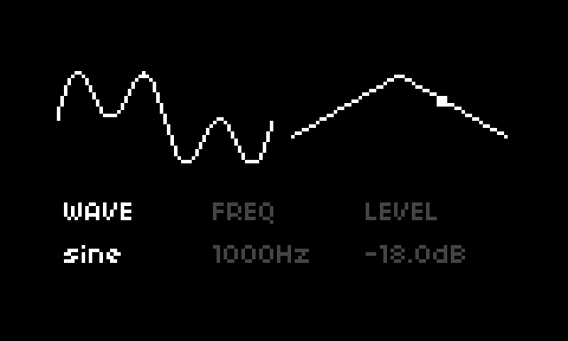

# signal



a signal generator build for [monome norns](https://monome.org/docs/norns/). If you need a test tone right now and don't have a function generator, and you have a norns, this turns it into one: sine, triangle, square, saw and white noise from 20 Hz to 20 kHz, two tones at once, a frequency sweep and a tone burst, set from the norns itself or from your computer over the network.

## what you need

- a norns (written on a shieldXL; any norns that runs scripts should do) and a way to copy a folder to it
- a cable from the norns's output jack to the thing you want to test
- something to look at the result: an oscilloscope is best. A true-RMS AC voltmeter, an audio interface, or just your ears will do for simple checks. Check your meter's frequency range: many only read correctly up to a few hundred hertz.

## install

```
;install https://github.com/loopmasta/signal
```

or copy this folder to `~/dust/code/signal` on the norns, so that `signal.lua` and `lib/Engine_Signal.sc` are there. You can do that with maiden (the norns's web editor, at `http://norns.local`) or with `scp` / SFTP. signal brings its own SuperCollider engine (`lib/Engine_Signal.sc`): after installing or updating, **restart norns once** (SYSTEM > RESTART), so SuperCollider picks it up. Then pick `signal` from the script list.

`select.png` is a background for the SELECT preview. Stock norns doesn't show it (it needs a small patch to the norns preview menu, see [shieldXL-trixie](https://github.com/loopmasta/shieldXL-trixie)), so it's optional.

## quick start

1. connect the norns output to what you want to test, **and to a scope or meter if you have one**. Read "connecting it" below first.
2. start `signal`. It starts with the output **off** and the level at -30 dB, so nothing happens yet.
3. turn E2 to FREQ and E3 to set the frequency. E2 to LEVEL, E3 to set the level.
4. press K3: the tone plays. The little square in the bottom right corner shows that a sound is playing. Press K3 again to stop.

## what you can do with it

- **a steady test tone:** sine at 1 kHz is the usual one. The presets (K1 + K2) jump to 100, 300, 400, 1000, 1200, 1750, 2200, 3000 and 5000 Hz.
- **frequency response of a filter, amplifier or speaker:** set a sweep (FROM, TO, TIME, then SWEEP up or down) and watch the output on a scope. The marker on the screen shows where the sweep is right now, so you know which frequency you are looking at.
- **intermodulation and mixing checks:** turn 2TONE on and set FREQ2. Both tones play together, each at half level, so the sum peaks at the level you set.
- **noise:** WAVE white noise, for checking channels, noise floors and hiss by ear or on a scope.
- **bursts:** K2 plays a tone burst (500 ms to start, set with BURST). Useful for gating, timing and level-control tests.
- **a shape check:** square and triangle waves show clipping, slew limits and bandwidth problems.

## the screen

the screen is one view in two areas.

- **top left:** the waveform, one cycle of the first tone (with 2TONE on, the sum of both tones). While a sound plays it is the actual signal the norns is producing, scaled to fill the view, so it shows the shape and not the level. When nothing plays it is the wave as you set it.
- **top right:** the sweep, as the frequency over one sweep on a log scale (20 Hz at the bottom, 20 kHz at the top) with a small box where the sweep is right now. With the sweep off it shows a dim line at the signal's frequency.
- **bottom:** the parameters, three at a time. E2 scrolls to the next ones (the others scroll out of view). The selected one is bright.

| control | action |
|---|---|
| E2 | scroll to the next / previous parameter |
| E3 | change the selected parameter |
| K2 | tone burst |
| K3 | output on / off |
| K1 + K2 | next frequency preset (after the last one, the first) |

on a frequency, E3 turns slowly for 1 Hz a tick and faster for 1 % a tick (times the speed). Level moves 0.5 dB a tick.

| parameter | what |
|---|---|
| WAVE | sine, triangle, square, saw, white noise |
| FREQ | 20 to 20000 Hz |
| LEVEL | dBFS (decibels below the norns's full scale), -80 to 0 |
| 2TONE | a second tone on or off |
| FREQ2 | the second tone's frequency |
| BURST | length of the tone burst on K2 |
| SWEEP | off, up (FROM to TO, then again from FROM), down (TO to FROM), up-down (up and back down) |
| FROM, TO | the sweep's end frequencies |
| TIME | seconds for one full sweep |
| RETRIG | off, or on: every time a sound starts (the output goes on, or a burst fires) the sweep starts again from its beginning, so it always begins at the same point |

the sweep is logarithmic, so every octave takes the same time. With RETRIG off it runs all the time, even while the output is off, so the output comes on at whatever point the sweep is at. With RETRIG on, the sweep jumps back to its start whenever a sound starts, which is what you want when you watch it on a scope.

the settings are saved and come back at the next start, except the output, which is always off after a start. They are also in the PARAMETERS menu, where they can be saved as presets (PSET) or mapped to MIDI.

## control it from your computer

norns listens for OSC on UDP port 10111, so any OSC tool can control it (TouchOSC, Max, python-osc, `oscsend`). For a computer with Python 3, `tools/signal_ctl.py` does it without installing anything:

```
tools/signal_ctl.py -H norns.local wave sine + hz 1000 + level -20 + on
tools/signal_ctl.py -H norns.local sweep up 300 3000 5
tools/signal_ctl.py -H norns.local burst 500
tools/signal_ctl.py -H norns.local on 0
tools/signal_ctl.py -H norns.local get
```

use the norns's IP address instead of `norns.local` if the name doesn't resolve. `on` alone means on, `on 0` means off. `get` prints the current settings (the answer comes back on UDP port 9000, so that port has to be free on your computer).

| path | arguments |
|---|---|
| `/signal/on` | 0 or 1 (no argument: on) |
| `/signal/toggle` | |
| `/signal/wave` | `sine` `triangle` `square` `saw` `white` (or 1-5) |
| `/signal/hz`, `/signal/hz2` | Hz, 20-20000 |
| `/signal/level` | dBFS, -80 to 0 |
| `/signal/amp` | linear, 0-1 |
| `/signal/tone2` | 0 or 1 |
| `/signal/sweep` | `off` `up` `down` `up-down`, optionally followed by from and to (Hz) and time (s) |
| `/signal/restart` | 0 or 1: the RETRIG setting |
| `/signal/retrigger` | start the sweep from its beginning now |
| `/signal/burst` | optional length in ms |
| `/signal/get` | answers `/signal/state` to the sender's address, on port 9000 |

## measuring the result with a network oscilloscope

if your scope can be controlled over the network with SCPI (a Rigol DS1000Z series was used here, port 5555), two more tools in `tools/` read it:

- `scope.py -H <scope ip> idn` shows what the scope is and the probe ratio and volts per division of each channel. `measure <channel>` reads Vpp, Vrms and frequency.
- `response.py --norns <norns ip> --scope <scope ip> --out 2 --in 1` plays a series of sine tones and prints the gain between two scope channels at each frequency (before and after the thing you test), as a table or a CSV file. It switches the output on and always off again at the end. It does not change the scope's settings: set the vertical scale and timebase first, and make the probe switch (1x / 10x) match the scope's probe setting.

the scope tools read and measure only. `scope.py` has been tried on a DS1202Z-E; the sweep in `response.py` has not been checked on real hardware yet.

## what it can and can't do

a norns is an audio device, not a lab generator. Know the limits before you trust a measurement.

- **audio range only:** 20 Hz to 20 kHz. It is no use for RF, and its output is for audio inputs.
- **level is not calibrated:** LEVEL is in dBFS, not volts. How many volts come out of your norns depends on its hardware, so measure it (below).
- **both outputs carry the same signal.**
- **purity:** the sine is a clean oscillator; the square and the saw are band-limited, but the triangle is not, so it can alias at high frequencies. Don't use it for distortion measurements of very good equipment.
- **no DC offset, no duty-cycle control, no external clock.**
- **frequency accuracy** follows the norns's audio clock. It is fine for checking a filter, but it is not a frequency standard: check against your own reference if it matters.

## connecting it

norns's line outputs can be far too hot for many inputs, and a mistake can damage the device you connect. **Measure first, connect after.**

- **Calibrate:** with the output on at 1 kHz and a scope on the norns output (not yet connected to anything else), note the Vpp at the level you use. Level is in dBFS, so -20 dB is a tenth of full scale, -40 dB a hundredth. Calibrate once, then use the levels you need.
- **Start low:** signal starts at -30 dB with the output off. Raise the level in small steps, with the scope connected.
- **Sensitive inputs:** for inputs that take a small signal (a microphone input, or a pin with a limited voltage range), use a resistor divider, not just a low level, so a wrong key press can't reach the input. Feed inputs with a DC bias through a capacitor.
- **Ground:** join the norns's audio ground to the ground of what you test (and the scope's), or the level readings are meaningless.
